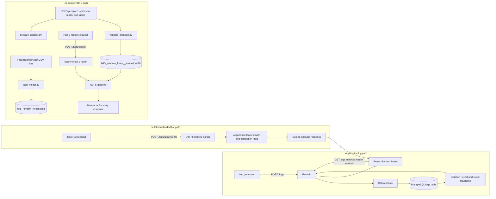

# AI Log Anomaly Detection and Root-Cause Analysis System

A college mini-project for collecting simulated application logs, storing them in PostgreSQL, and exploring anomaly and incident-analysis results through a React dashboard. It also includes a separate HDFS block-anomaly pipeline and prediction endpoint.

## Problem Statement

Application logs are verbose and distributed across services. Manually finding error bursts and the events around them takes time. This project demonstrates how a small log-analysis pipeline can summarize stored or uploaded logs and present likely incident leads. Its scores and root-cause ranking are heuristics for investigation, not proof of causation or production-grade diagnosis.

## Objectives

- Collect structured application log events and store them in PostgreSQL.
- Summarize and inspect database logs through the dashboard.
- Flag application-log anomalies with the existing Isolation Forest features and timestamped error-burst rule.
- Correlate nearby ERROR/WARNING events and rank a probable root-cause candidate.
- Analyze uploaded `.log`/`.txt` files independently without inserting their contents into PostgreSQL.
- Keep the HDFS dataset/model flow separate from arbitrary application-log analysis.

## Key Features

- Live log table with search, severity/service filters, detail view, and CSV export.
- Rule-based Service Health Overview from stored logs.
- Log Analytics & Trends backed by database-only severity counts and time buckets.
- Incident investigation dialog with observed events, detected anomalies, inferred root-cause candidate, recovery events when present, and heuristic confidence.
- Isolated file analysis with line validation, rejected-line reporting, and a 2 MiB / 20,000-line limit.
- Separate HDFS prediction endpoint using the saved HDFS Random Forest model.

## Architecture and Data Flow



### Application Log Analysis

`log_generator/generator.py` writes each event to `data/logs/application.log` and POSTs the structured record to `/logs`. The FastAPI log route persists those records using SQLAlchemy. The dashboard polls `/logs`, `/logs/analyze`, `/services/health`, and `/logs/analytics`.

The application anomaly detector uses four numeric features: ERROR flag, WARNING flag, message length, and service-name length. With at least five logs it runs the existing Isolation Forest; it also flags timestamped ERRORs that are within 10 seconds of another ERROR. An ERROR is not automatically an anomaly.

Event correlation includes ERROR/WARNING events within the existing 10-second window from the first issue. File analysis can additionally identify INFO recovery messages from involved services within 10 seconds after the last issue. Recovery matching is keyword-based.

The probable root-cause candidate is selected by service-priority and timestamp heuristics (`database`, `auth`, `payment`, `order`, `api`, then earliest ERROR). A related event is observed data; a probable root cause is an inference. Correlation does not prove causation. The confidence number is a heuristic score, not a calibrated probability.

### Uploaded Files

Uploads use the generator's line format:

```text
YYYY-MM-DD HH:MM:SS | service | level | message
```

The endpoint accepts UTF-8 `.log` and `.txt` files up to 2 MiB and 20,000 lines. Supported levels are INFO, WARNING, and ERROR. Malformed lines are reported instead of being treated as valid logs. The file is analyzed in its separate request path; it is not inserted into PostgreSQL and does not affect database analytics or the database log table.

### Service Health and Analytics

`GET /services/health` aggregates all stored logs by service. Critical means at least one ERROR; Warning means no ERROR and at least one WARNING; Healthy means neither. These are explicit rule-based statuses, not ML predictions.

`GET /logs/analytics` returns database-only total and severity counts, unknown-severity count, invalid-timestamp count, adaptive volume buckets, and the IDs included in the result. The dashboard shows an anomaly/normal summary only when those IDs match the IDs returned by `/logs/analyze`, avoiding a mixed-dataset count.

### HDFS Pipeline

The HDFS data under `data/hdfs/preprocessed` is prepared by `ml/prepare_dataset.py` or handled by the grouped validation/training flow in `ml/validate_grouped.py`. The HDFS route loads `ml/models/hdfs_random_forest_grouped.joblib` and uses the model's feature names/order for `/hdfs/predict`. This model is trained for the HDFS event-count dataset; it is not used as a general application-log model. No model retraining is required to run the API if the saved model file is present.

## Technology Stack

- Python, FastAPI, SQLAlchemy, PostgreSQL, and `psycopg2-binary` for the backend and storage.
- scikit-learn Isolation Forest for application-log anomaly features.
- React and Vite for the dashboard; SVG and CSS provide the charts without an additional charting dependency.
- pandas and joblib for the separate HDFS model/data path.
- Python `unittest` and Node's built-in test runner for automated tests.

## Windows Setup

### Prerequisites

- Python 3 and Node.js with npm.
- PostgreSQL running locally.
- A PostgreSQL database named `log_analyzer`.

Create the database once, for example from `psql`:

```sql
CREATE DATABASE log_analyzer;
```

From PowerShell at the repository root, create the environment and install the declared backend requirements:

```powershell
py -m venv venv
.\venv\Scripts\python.exe -m pip install --upgrade pip
.\venv\Scripts\python.exe -m pip install -r requirements.txt
```

The current HDFS detector imports pandas, but `pandas` is not listed in `requirements.txt`. Install it separately for the backend app to import the HDFS route:

```powershell
.\venv\Scripts\python.exe -m pip install pandas
```

Install frontend packages using the lockfile:

```powershell
Push-Location frontend
npm ci
Pop-Location
```

### PostgreSQL Configuration

Create a root-level `.env` file from `.env.example` and set `DATABASE_URL` to your local database. Use your own local values; do not commit `.env` or put credentials in this README. URL-encode special characters in the password.

```dotenv
DATABASE_URL=postgresql://<username>:<password>@localhost:5432/log_analyzer
```

The backend loads `.env` from the repository root. The application creates the `logs` table from the existing SQLAlchemy model at startup; it does not define migrations or additional tables.

### Start the Backend and Dashboard

Start the FastAPI server from the repository root:

```powershell
.\venv\Scripts\python.exe -m uvicorn backend.app.main:app --reload
```

Start Vite in a second PowerShell terminal:

```powershell
Set-Location frontend
npm run dev
```

Open the URL printed by Vite, normally `http://localhost:5173`. The backend CORS configuration permits both `http://localhost:5173` and `http://127.0.0.1:5173`. Interactive API docs are at `http://127.0.0.1:8000/docs`.

### Generate Sample Application Logs

After the backend is running, execute this from the repository root:

```powershell
.\venv\Scripts\python.exe log_generator\generator.py
```

The generator emits a fixed finite sequence of INFO and ERROR events. Each run appends to `data/logs/application.log` and attempts to POST each event to PostgreSQL; it does not clear existing logs and does not retry failed requests.

### Upload and Analyze a Log File

Use **Analyze a log file** in the dashboard to select a UTF-8 `.log` or `.txt` file. For a command-line request from PowerShell, use `curl.exe`:

```powershell
curl.exe -F "file=@data/logs/application.log" http://127.0.0.1:8000/logs/analyze-file
```

The response reports parsed and rejected lines, anomalies, related events, probable root-cause candidate, recovery events when identified, severity, heuristic confidence, and explanation. This request does not save uploaded content to PostgreSQL.

## API Reference

| Method | Endpoint | Purpose |
| --- | --- | --- |
| `GET` | `/` | Backend status. |
| `POST` | `/logs` | Validate and save one structured application log. |
| `GET` | `/logs` | Return database logs ordered newest first. |
| `GET` | `/logs/analyze` | Analyze stored database logs; response fields remain `analyzed_logs`, `related_events`, `probable_root_cause`, `severity`, `confidence`, and `explanation`. |
| `GET` | `/logs/analytics` | Return database-only log totals, severity counts, time buckets, invalid timestamp count, and analysis-matching log IDs. |
| `GET` | `/services/health` | Return per-service totals, ERROR/WARNING counts, most-recent valid timestamp, and rule-based status. |
| `POST` | `/logs/analyze-file` | Analyze an isolated uploaded `.log`/`.txt` file; does not write to PostgreSQL. |
| `POST` | `/hdfs/predict` | Classify one HDFS event-count feature record using the saved HDFS model. |

Example `POST /logs` JSON body:

```json
{
  "timestamp": "2026-10-22 12:00:00",
  "service": "database",
  "level": "ERROR",
  "message": "Database connection failed"
}
```

The HDFS endpoint expects a `features` object with exactly the feature names and values required by the saved model. Feature names and order come from the model; values must be non-negative integers. The HDFS test script reads a row from the preprocessed HDFS event-occurrence matrix and checks valid and invalid payloads.

## Tests and Validation

Run from the repository root in PowerShell:

```powershell
.\venv\Scripts\python.exe -m unittest discover -s tests -v
npm --prefix frontend test
npm --prefix frontend run lint
npm --prefix frontend run build
git diff --check
```

The Python suite uses temporary SQLite databases for API integration tests; it does not require test records in the development PostgreSQL database. The frontend incident-detail tests use Node's built-in test runner and do not add a test dependency.

### Latest Verified Results

Verified on 2026-10-22 from the repository root:

- Python: `python -m unittest discover -s tests -v` — 45 tests passed.
- Frontend: `npm --prefix frontend test` — 7 tests passed.
- Frontend: `npm --prefix frontend run lint` — passed.
- Frontend: `npm --prefix frontend run build` — passed.
- Diff: `git diff --check` — no whitespace errors. Git printed existing LF-to-CRLF warnings for modified frontend files.

The live API scripts below were not part of this test run; they require a running backend.

For live API checks, start the backend first and then run:

```powershell
.\venv\Scripts\python.exe scripts\test_live_logs_api.py
.\venv\Scripts\python.exe scripts\test_hdfs_endpoint.py
```

These scripts make live HTTP requests. The HDFS script sends prediction requests; the live log API check reads the API and OpenAPI routes.

## Current Limitations

- Database analysis, service health, and analytics use all stored logs; the API does not provide pagination or a configurable analysis window.
- Application anomaly detection uses a small feature set and a deterministic Isolation Forest fit over the current input plus an ERROR-burst rule. Results can change with dataset composition.
- Event correlation is timestamp-window based. Recovery identification is INFO-message keyword based. Neither correlation nor the service-priority root-cause candidate proves causation.
- Confidence is heuristic, not a calibrated probability. Incident details are reconstructed from the current analysis response; there are no persistent incident records.
- Only the documented timestamp format is parsed for correlation and volume buckets; invalid or missing timestamps are excluded from time-based operations and counted/reported where supported.
- The sample generator is fixed and does not retry failed API requests. Its output file and database records are append-only unless separately cleared by the user.
- `pandas` is required by the HDFS route at backend import time but is not currently declared in `requirements.txt`; the setup step above installs it explicitly.
- The HDFS Random Forest is specific to the HDFS event-count dataset and must not be interpreted as an application-log classifier.

Treat anomaly counts, health statuses, incident timelines, root-cause candidates, and confidence scores as demonstration and investigation aids, not production diagnoses.